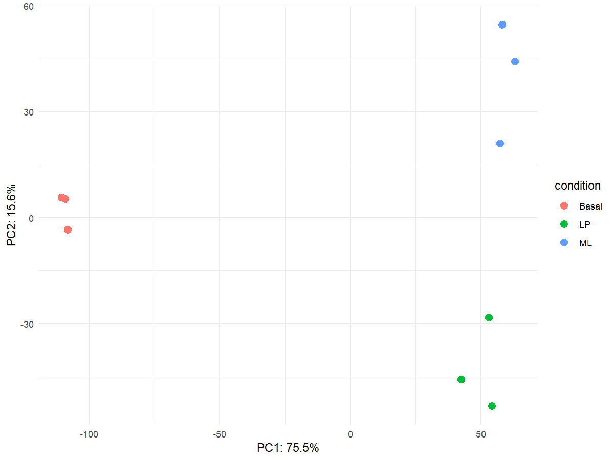
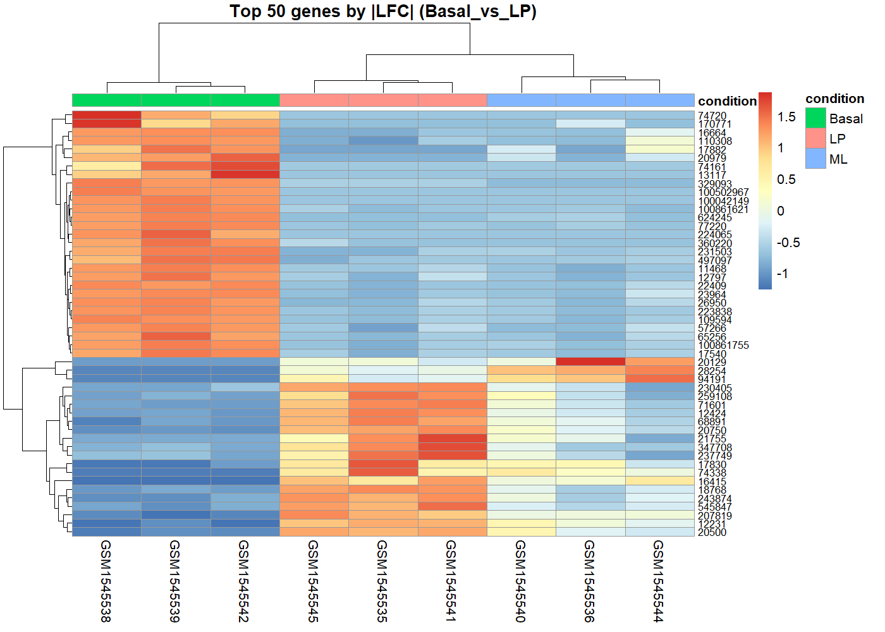

# RNA-seq Differential Expression Pipeline

Differential gene expression analysis of mouse mammary epithelial cell populations, using Python to build the count matrix, DESeq2 in R for the statistics and plots, and a Bash script to run the whole workflow.

**Author:** Jillian Higbee
**Dataset:** [GEO GSE63310](https://www.ncbi.nlm.nih.gov/geo/query/acc.cgi?acc=GSE63310)

## Question

How does gene expression differ between basal mammary epithelial cells and the more differentiated luminal cell populations?

## Data

Sorted mouse mammary epithelial cells, three biological replicates per group:

| Group | Role | Samples |
|---|---|---|
| Basal | reference group | 3 |
| Luminal Progenitor (LP) | compared to Basal | 3 |
| Mature Luminal (ML) | compared to Basal | 3 |

Two other samples in the GEO series (Mammosphere, CommaDB) were excluded to keep the comparison focused on the three primary cell populations. Sample IDs are listed in [`data/README.md`](data/README.md).

## Methods

1. **Count matrix (Python, pandas):** merge per-sample GSM count files into one genes-by-samples matrix and filter low-count genes (at least 10 counts in at least 3 samples).
2. **Differential expression (R, DESeq2):** negative binomial model with design `~ condition`, Basal as reference; contrasts LP vs Basal and ML vs Basal.
3. **Multiple testing:** Benjamini-Hochberg adjusted p-values.
4. **Effect sizes:** log2 fold-change shrinkage with apeglm.
5. **Plots:** PCA on variance-stabilized counts, MA plots, and heatmaps of the top 50 genes by absolute log2 fold change.

## Results

Genes tested: 16,545. Significant at adjusted p < 0.05:

| Comparison | Significant genes | Higher in LP/ML | Lower in LP/ML | Also \|log2FC\| > 1 |
|---|---|---|---|---|
| LP vs Basal | 9,539 | 4,669 | 4,870 | 5,831 |
| ML vs Basal | 9,757 | 4,789 | 4,968 | 6,026 |

7,390 genes are significant in both comparisons. A positive log2 fold change means higher expression in LP or ML than in Basal. (Files are named `Basal_vs_X` but the fold change is X relative to Basal.)



PC1 (75.5% of variance) separates Basal from the two luminal populations, and PC2 (15.6%) separates LP from ML.



More detail on each figure is in [`results/README.md`](results/README.md).

## Limitations

- Only three replicates per group, and no batch or sequencing-lane variable in the model.
- Bulk RNA-seq, so differences within a cell population cannot be resolved.
- Genes are identified by numeric IDs (they appear to be Entrez Gene IDs); no gene-symbol annotation or pathway enrichment yet.
- Only comparisons against Basal were run (no direct LP vs ML contrast).
- Results are computational and not experimentally validated.

## Repository structure

```
.
├── data/
│   ├── README.md                # sample list and download instructions
│   └── processed/
│       └── metadata_cleaned.csv # sample-to-condition table
├── scripts/
│   ├── inspect_one_gsm.py       # sanity-check the format of one count file
│   ├── merge_gsm_to_matrix.py   # build and filter the count matrix
│   ├── deseq2.R                 # DESeq2 analysis and plots
│   └── run_pipeline.sh          # runs the full workflow
├── results/                     # tables and figures
└── requirements.txt
```

## Reproducing the analysis

**Requirements:** conda, Python 3.11, R with Bioconductor, Bash.

1. Create the Python environment:

   ```bash
   conda create -n bio-p2 python=3.11
   conda activate bio-p2
   pip install -r requirements.txt
   ```

2. Install the R packages (one time):

   ```bash
   Rscript -e "if (!requireNamespace('BiocManager',quietly=TRUE)) install.packages('BiocManager', repos='https://cloud.r-project.org'); BiocManager::install(c('DESeq2','apeglm')); install.packages(c('ggplot2','ggrepel','pheatmap'), repos='https://cloud.r-project.org')"
   ```

3. Download the GSM count files listed in `data/README.md` from GEO (GSE63310) and place them in `data/dev/`.

4. From the project root, run the pipeline:

   ```bash
   bash scripts/run_pipeline.sh
   ```

Outputs are written to `results/` and `data/processed/deseq2/`. R package versions used are saved to `sessionInfo.txt` in the DESeq2 output folder.

## Citations

- Love, M.I., Huber, W., Anders, S. (2014). Moderated estimation of fold change and dispersion for RNA-seq data with DESeq2. *Genome Biology*, 15, 550. https://doi.org/10.1186/s13059-014-0550-8
- Zhu, A., Ibrahim, J.G., Love, M.I. (2019). Heavy-tailed prior distributions for sequence count data: removing the noise and preserving large differences. *Bioinformatics*, 35(12), 2084-2092. https://doi.org/10.1093/bioinformatics/bty895
